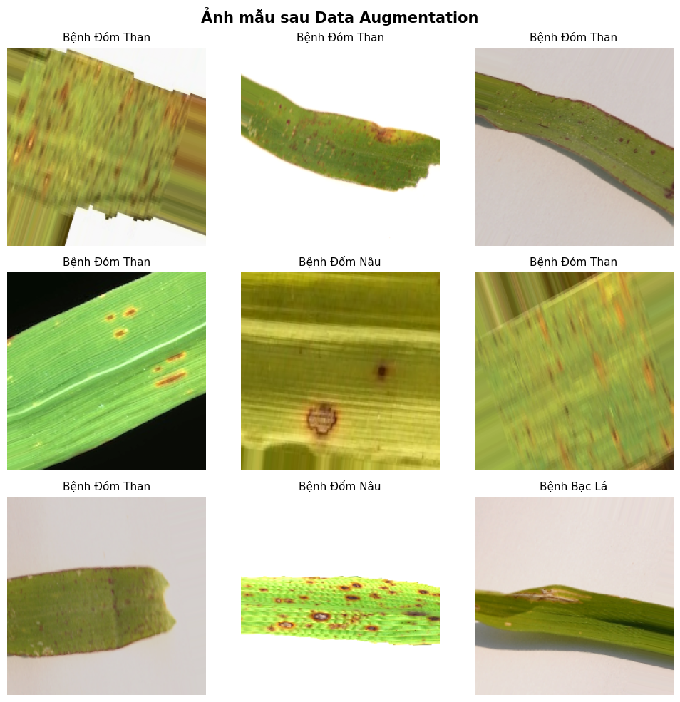
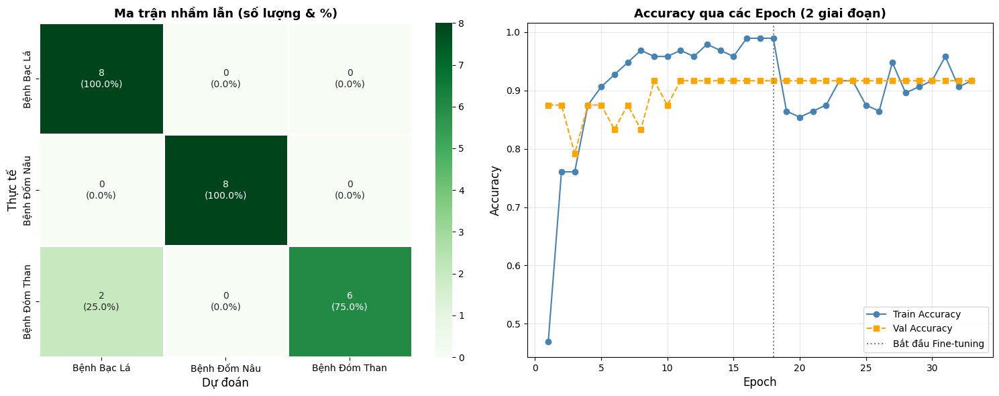
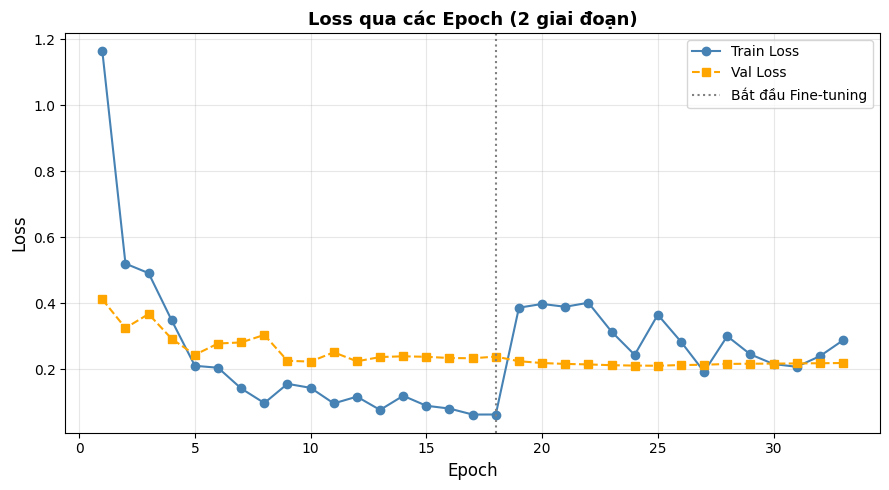
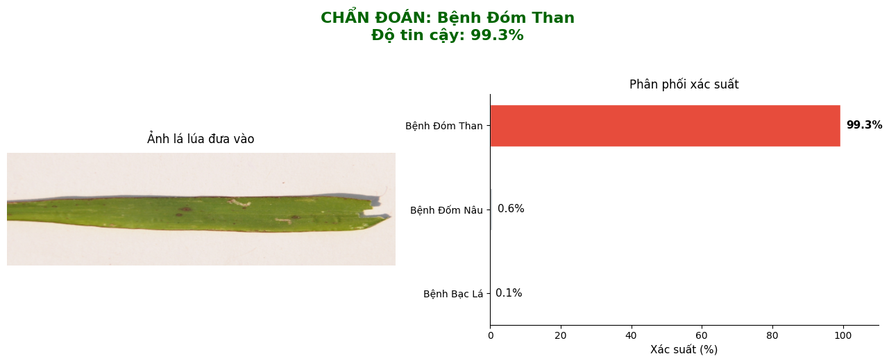
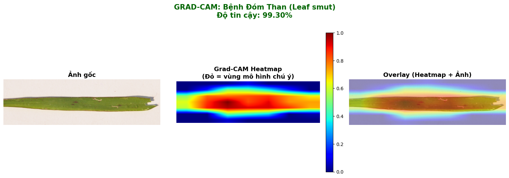

# 🌾 Rice Leaf Disease Detection using CNN & Data Augmentation

<p align="center">
  
  
  
  
  
</p>

<p align="center">
  An end-to-end Computer Vision & Deep Learning pipeline for automated classification of rice leaf diseases, developed by <strong>Đặng Đại Lợi (<a href="https://github.com/ddloi">@ddloi</a>)</strong>.
</p>

---

## 📌 Executive Summary

Rice is the primary staple crop in Vietnam and Southeast Asia. Early and accurate detection of foliar diseases is critical to safeguarding agricultural yields. This research project implements a full deep learning workflow:
1. **Curates & normalizes** rice leaf images across 4 distinct health categories.
2. **Applies data augmentation** to balance class distribution and prevent overfitting.
3. **Trains a Convolutional Neural Network (CNN)** with BatchNormalization and Dropout regularization.
4. **Evaluates performance** with class-wise Precision, Recall, F1-Score, and Confusion Matrix.

---

## 📸 Visual Showcase & Demo Figures

### 1. Dataset Samples
<p align="center">
  
  <br/>
  <em>Figure 1: Representative leaf samples across Healthy, Bacterial Leaf Blight, Brown Spot, and Leaf Smut classes.</em>
</p>

### 2. Data Augmentation Pipeline
<p align="center">
  
  <br/>
  <em>Figure 2: Real-time image augmentation transformations (rotation, horizontal flip, zoom, illumination shifts).</em>
</p>

### 3. Model Training History
<p align="center">
  
  <br/>
  <em>Figure 3: Training vs. Validation Loss and Accuracy convergence curves across epochs.</em>
</p>

### 4. Confusion Matrix & Classification Metrics
<div align="center">
  <table>
    <tr>
      <td align="center"><strong>Confusion Matrix</strong></td>
      <td align="center"><strong>Classification Report Heatmap</strong></td>
    </tr>
    <tr>
      <td></td>
      <td></td>
    </tr>
  </table>
</div>

---

## 🏷️ Disease Classification Taxonomy

| Class | Causative Agent | Key Symptoms |
| :--- | :--- | :--- |
| **Healthy** | None | Uniform green leaves, no lesions or discoloration |
| **Bacterial Leaf Blight** | *Xanthomonas oryzae* | Water-soaked to yellowish-white stripes along leaf margins |
| **Brown Spot** | *Bipolaris oryzae* | Small, oval to circular dark brown lesions with yellow halo |
| **Leaf Smut** | *Entyloma oryzae* | Slightly raised angular black spots scattered on leaf blades |

---

## 🏗️ Deep Learning Architecture

```text
Input Image (224 x 224 x 3)
   │
   ├── Conv2D (32 filters, 3x3) ──▶ BatchNorm ──▶ ReLU ──▶ MaxPool2D (2x2)
   ├── Conv2D (64 filters, 3x3) ──▶ BatchNorm ──▶ ReLU ──▶ MaxPool2D (2x2)
   ├── Conv2D (128 filters, 3x3) ──▶ BatchNorm ──▶ ReLU ──▶ MaxPool2D (2x2)
   │
   ├── Flatten
   ├── Dense (256 units) ──▶ ReLU ──▶ Dropout (0.5)
   └── Dense (4 units, Softmax) ──▶ Multi-class Disease Prediction
```

- **Optimizer:** Adam (`lr = 0.001`)
- **Loss Function:** Categorical Cross-Entropy
- **Regularization:** Batch Normalization, Dropout (50%), Data Augmentation

---

## 🚀 Reproduction & How to Run

### 1. Clone the Repository
```bash
git clone https://github.com/ddloi/rice-leaf-disease-cnn.git
cd rice-leaf-disease-cnn
```

### 2. Environment Setup
```bash
pip install tensorflow opencv-python numpy pandas matplotlib seaborn scikit-learn jupyter
```

### 3. Run Jupyter Notebook
```bash
jupyter notebook rice_leaf_disease_detection.ipynb
```

---

## 👨‍💻 Author & Contact

- **Developer:** Đặng Đại Lợi
- **GitHub:** [@ddloi](https://github.com/ddloi)
- **Email:** [dangdailoi732006@gmail.com](mailto:dangdailoi732006@gmail.com)
- **LinkedIn:** [ddloi](https://www.linkedin.com/in/ddloi)
- **Institution:** HUFLIT (Ho Chi Minh City University of Foreign Languages & Information Technology)
